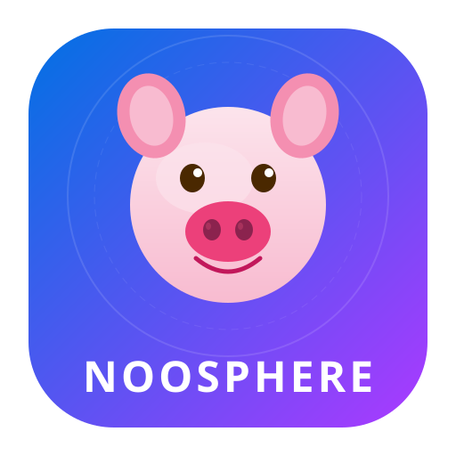

<div align="center">



# NOOSPHERE · 个人开发者仪表盘

**Apple 设计 × 游戏 UI × 互联网幽默**

[](https://react.dev)
[](https://www.typescriptlang.org/)
[](https://vitejs.dev)
[](https://tailwindcss.com)
[](https://www.framer.com/motion/)

</div>

---

## 预览

```
┌──────────┬───────────────────────────────────────────┐
│  左侧栏   │              主内容区                       │
│          │                                           │
│  ┌────┐  │  ┌─────────────────────────────────────┐  │
│  │头像│  │  │  开发日志 (图片背景 · 可滚动阅读)      │  │
│  │姓名│  │  │  文章1 · 文章2 · 文章3 ...            │  │
│  │统计│  │  └─────────────────────────────────────┘  │
│  └────┘  │                                           │
│          │  ┌───────┬─────────┬──────────┐          │
│  技术栈   │  │代码仓库│ 最近活动 │ 关于     │          │
│          │  │(图片) │         │          │          │
│  联系    │  └───────┴─────────┴──────────┘          │
└──────────┴───────────────────────────────────────────┘
```

## 特性

| 模块 | 说明 |
|------|------|
| 👤 开发者资料 | GitHub 实时头像 + 统计 + 技能矩阵 + 社交链接 |
| 📝 开发日志 | 11 篇文章，首页摘要预览，点击跳转详情 |
| 📦 代码仓库 | GitHub API 实时同步仓库列表 |
| ⚡ 最近活动 | GitHub Events 活动时间线 |
| 🐷 漂浮猪猪 | Google Noto Emoji 风格 SVG 猪猪背景动画 |
| 🖼️ 图片背景 | 3 张自定义图片嵌入模块卡片 |

## 技术栈

| 层面 | 选型 |
|------|------|
| 框架 | React 18 + TypeScript |
| 构建 | Vite 6 |
| 样式 | Tailwind CSS 3 |
| 动画 | Framer Motion 11 |
| 路由 | React Router 6 |
| 图标 | 内联 SVG (GooglePig) |
| 数据 | GitHub REST API |

## 快速开始

```bash
# 1. 安装依赖
npm install

# 2. 启动开发服务器
npm run dev

# 3. 构建生产版本
npm run build

# 4. 预览生产版本
npm run preview
```

## 项目结构

```
portfolio/
├── public/
│   ├── logo.svg          # 项目 LOGO
│   ├── favicon.svg       # 浏览器图标
│   ├── bg-1.jpg          # 背景图片 1
│   ├── bg-2.jpg          # 背景图片 2
│   └── bg-3.jpg          # 背景图片 3
├── src/
│   ├── components/
│   │   ├── dashboard/
│   │   │   ├── AppleDashboard.tsx   # 首页仪表盘
│   │   │   ├── GooglePig.tsx        # Google 风格猪猪 SVG
│   │   │   ├── PigEmoji.tsx         # 漂浮猪猪动画
│   │   │   └── TerminalHeader.tsx   # 顶部状态栏
│   │   ├── layout/
│   │   │   ├── Navbar.tsx           # 导航栏
│   │   │   └── Footer.tsx           # 页脚
│   │   ├── blog/
│   │   │   └── BlogPostView.tsx     # 博客文章详情
│   │   └── ui/                      # 通用 UI 组件
│   ├── pages/
│   │   ├── Home.tsx                 # 首页
│   │   ├── Blog.tsx                 # 博客列表
│   │   └── BlogPost.tsx             # 博客详情
│   ├── data/
│   │   ├── profile.ts              # 个人资料
│   │   └── blog-posts.ts           # 博客文章 (11篇)
│   ├── services/
│   │   └── github.ts               # GitHub API 服务
│   ├── lib/
│   │   ├── motion.ts               # 动画令牌
│   │   └── utils.ts                # 工具函数
│   ├── App.tsx
│   ├── main.tsx
│   └── index.css
├── index.html
├── tailwind.config.js
├── tsconfig.json
├── vite.config.ts
└── package.json
```

## 配色

| 令牌 | 色值 | 用途 |
|------|------|------|
| Apple 蓝 | `#0071e3` | 主强调色 |
| 明亮紫 | `#ac39ff` | 次级强调 |
| Apple 橙 | `#ff9f0a` | 暖色点缀 |
| Apple 绿 | `#30d158` | 在线状态 |
| Apple 粉 | `#ff375f` | 装饰色 |
| 背景灰 | `#f5f5f7` | 页面底色 |

## License

MIT
